# Internal API Portal

Self-hosted internal API documentation and controlled invocation portal for OpenAPI / Swagger documented services running inside Kubernetes or other private networks.

The browser never talks directly to internal service DNS names or upstream OpenAPI endpoints. All spec retrieval and API invocation flows are mediated by the Go backend.

| | Light | Dark |
|---|---|---|
| Catalog | 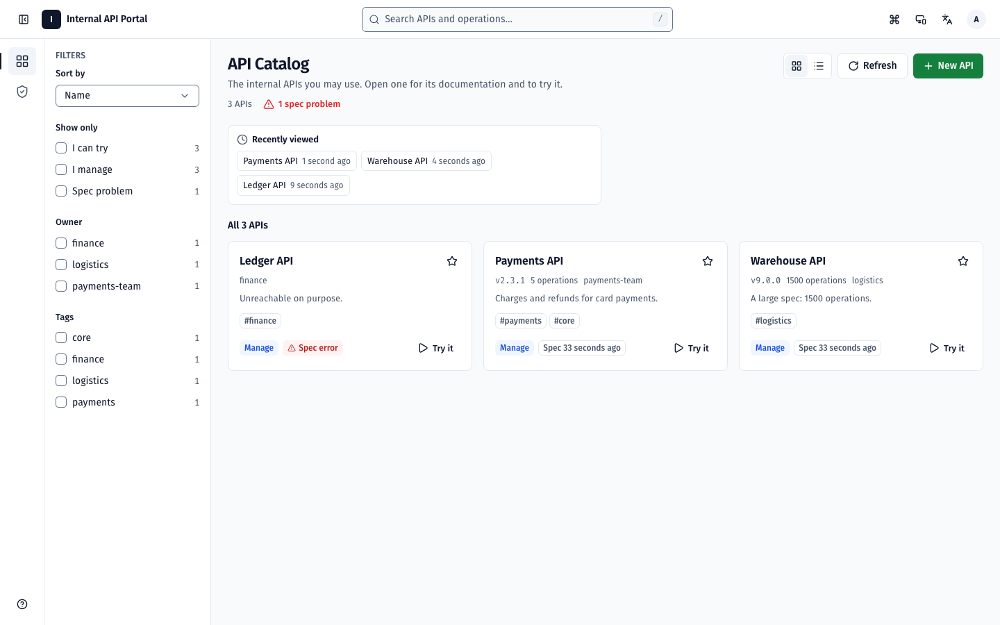 | 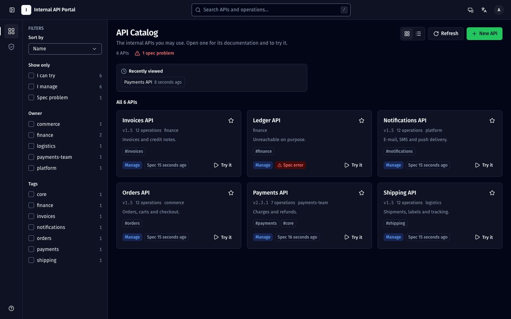 |
| API reference and try-it | 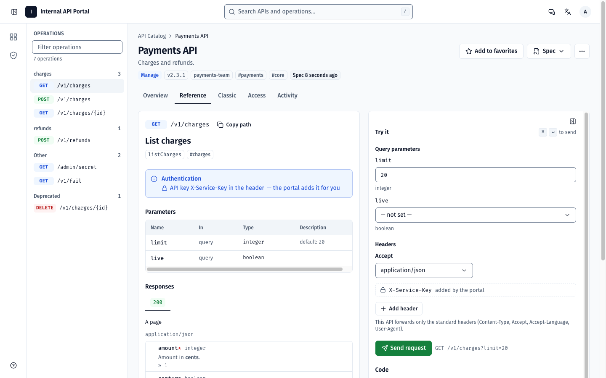 | 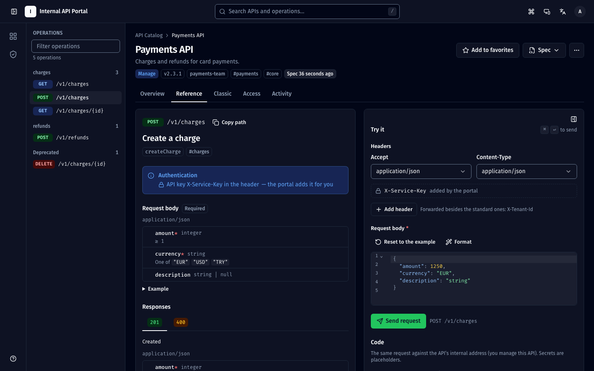 |
| Admin overview | 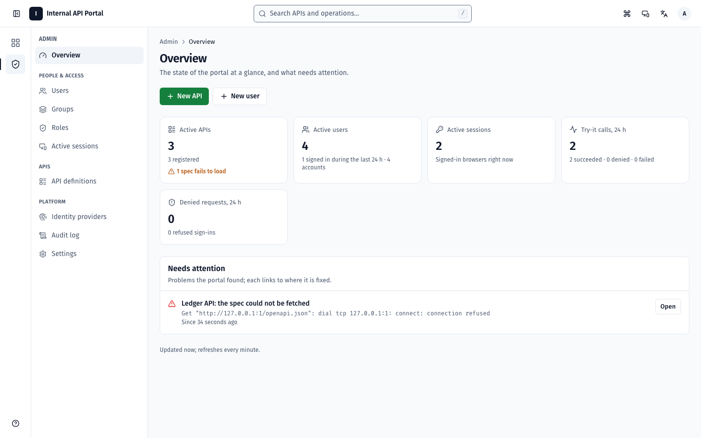 | 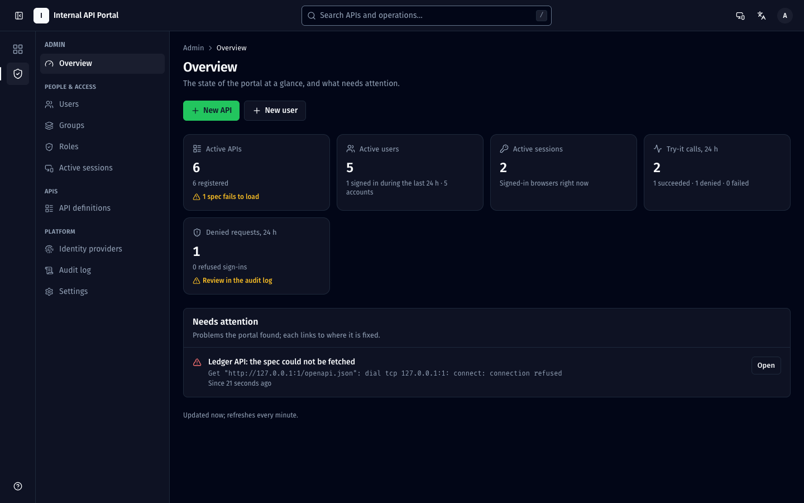 |
| Users, API wizard | 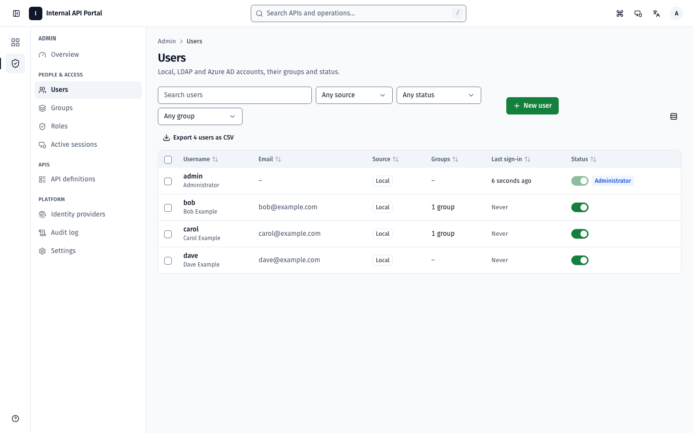 | 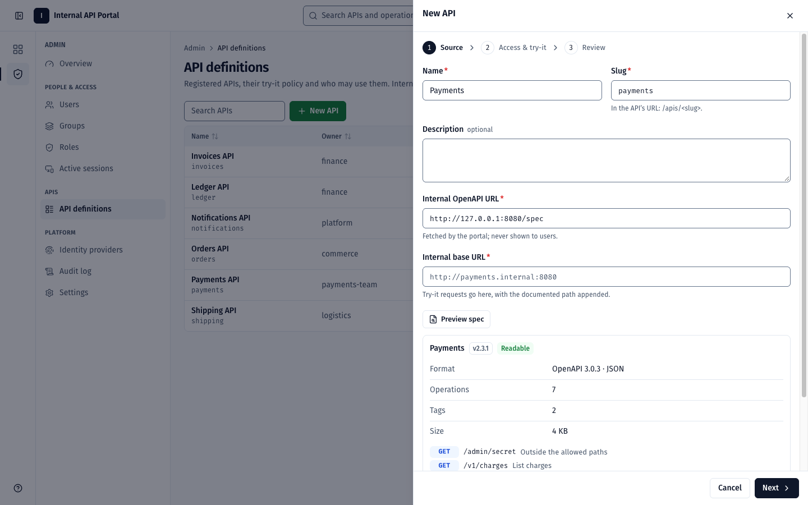 |
| Command palette (⌘K) | 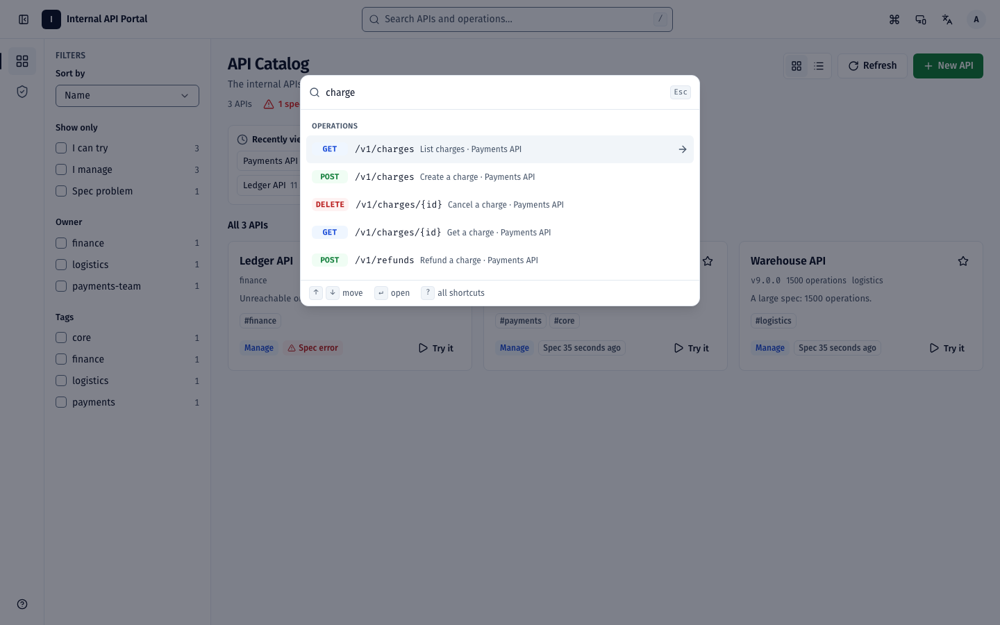 | 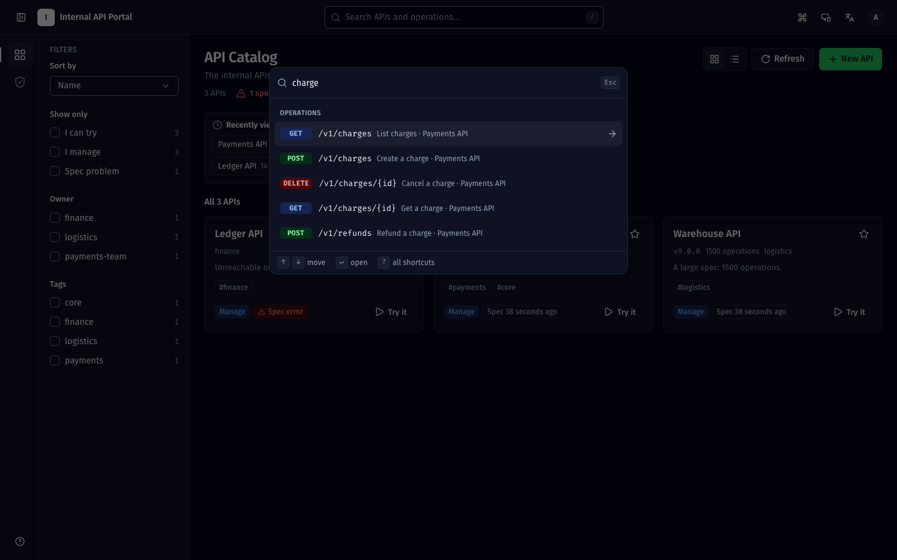 |
| Phone (375 px) | 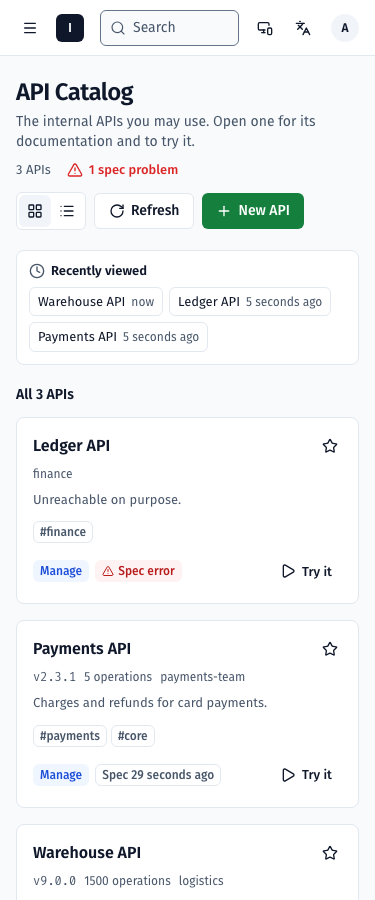 | 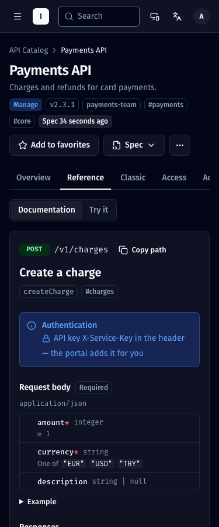 |

The interface is in English and Turkish, follows the system light / dark setting (or a chosen one), works from 375 px phones to wide screens, and can be used entirely from the keyboard (see Keyboard). CI checks WCAG 2.2 AA in a real browser on every route.

## What This Product Is

This application is an internal API portal for platform teams, backend teams, and internal consumers who need to:

- browse an internal API catalog
- read OpenAPI / Swagger documentation
- authenticate with local users or LDAP
- authorize access through app-layer RBAC
- invoke internal APIs safely through a backend proxy
- audit who logged in, viewed specs, refreshed specs, and invoked APIs

This is not a Kubernetes resource dashboard. It does not manage pods, deployments, namespaces, or cluster resources for end users.

## Core Capabilities

- Single Docker image containing frontend and backend
- Go backend serving the React frontend
- SQLite persistence with startup migrations
- Local authentication with Argon2id password hashing
- LDAP bind authentication with admin-managed LDAP settings
- Azure AD login with admin-managed OIDC settings
- App-layer RBAC with users, groups, roles, permissions
- Per-API authorization with global and resource-scoped permissions
- Backend-only OpenAPI fetch and cache
- Backend-only try-it-out proxy: method / path allowlists, header filtering, no redirect following, and a network guard that refuses metadata, link-local and loopback addresses
- Catalog with search across APIs and their operations, favorites and recently viewed APIs, filters in the URL
- API workspace: reference built from the spec, a schema-driven try-it console, code snippets, spec history
- Admin console: an overview of what needs attention, users (bulk actions, effective permissions), groups and members, roles with templates, API registration wizard with spec preview, identity providers, sessions, audit log, settings
- Audit retention with configurable purge window
- `/healthz` for readiness and liveness probes

## Architecture

```text
Browser
  -> same-origin requests
Portal Frontend (React + TypeScript)
  -> same-origin API calls
Portal Backend (Go + chi)
  -> SQLite
  -> LDAP
  -> internal OpenAPI endpoints
  -> internal upstream APIs
```

### Security Boundary

The portal backend is the security boundary.

- The browser does not fetch internal OpenAPI docs directly.
- The browser does not call internal APIs directly.
- The backend validates identity, permissions, API registration, methods, paths, headers, body size, response size, and timeout before proxying.
- The portal is not a generic proxy.

## Project Layout

```text
backend/
  cmd/server          entry point; also the healthcheck / backup / version commands
  internal/api        HTTP handlers (one file per area), middleware, authorization table test
  internal/auth       passwords, LDAP, Azure AD
  internal/audit      audit log writer and retention
  internal/config     environment variables
  internal/db         SQLite connection, versioned migrations, backups
  internal/logging    slog setup, ECS JSON handler, redaction, request ids
  internal/metrics    Prometheus text-format metrics
  internal/models
  internal/netguard   dial-time guard for upstream connections
  internal/openapi    spec fetching and sanitising
  internal/proxy      try-it forwarding
  internal/rbac
  internal/store      queries, one file per entity

frontend/
  src/components/ui     design-system components (Radix primitives + tokens)
  src/components/shell  top bar, nav rail, section panel, navigation drawer
  src/pages             routes (admin sections lazy-loaded one by one)
  src/lib               API client, query client, theme, formatting, OpenAPI parsing
  src/i18n              English and Turkish dictionaries
  src/styles/app.css    design tokens (light / dark)

deploy/               kustomize manifests (+ optional ingress / network policy examples)
deploy/logging/       Elasticsearch templates, ILM, Fluent Bit / Filebeat examples
.github/              CI and Dependabot
```

## Technology Stack

### Backend

- Go (1.26+; images are built with the latest Go 1.27 patch)
- chi router
- SQLite (WAL, foreign keys, versioned migrations)
- server-side sessions (HttpOnly cookie), Argon2id passwords
- go-ldap
- `log/slog` structured logging, Prometheus metrics

### Frontend

- React 18, TypeScript, Vite, React Router (lazy routes)
- Tailwind CSS 4 with design tokens (CSS variables) for the light and dark themes; Radix UI primitives for accessible dialogs, menus, selects and tooltips; lucide-react icons
- TanStack Query (cache, targeted refetch after writes), react-hook-form + zod
- react-i18next: English and Turkish (language picker, else the browser's language)
- Self-hosted Fira Sans / Fira Code (no third-party requests; the CSP allows none)
- `swagger-ui-react` for read-only documentation rendering, loaded only on the documentation tab
- Vitest, Testing Library and axe-core for tests; ESLint (typescript-eslint, react-hooks, jsx-a11y) and Prettier

The design rules (tokens, contrast pairs, spacing, component contracts) are in the milestones repository (`DESIGN_SYSTEM.md`). Components use only token classes (`bg-background`, `text-muted-foreground`, …); a lint rule rejects palette classes and raw hex colors. `npm run dev` serves a component gallery at `/__ui` (development builds only).

## Data Model

Primary tables:

- `users`
- `groups`
- `roles`
- `permissions`
- `user_groups`
- `group_roles`
- `ldap_config`
- `session_settings`
- `api_definitions`
- `api_spec_cache`
- `audit_logs`
- `app_secrets`
- `system_settings`

## RBAC Model

Authorization happens in the portal (not in the upstream APIs):

```text
User -> Group -> Role -> Permission (scope)
```

plus two per-API shortcuts that don't need roles:

- **Owner group** of an API: its members get `api:<id>:manage` on that API.
- **Access** of an API (Admin → API definitions → Access): groups get `api:<id>:view` or `api:<id>:invoke` on that API.

So a group's members get permissions from three places: **the group's roles**, **the APIs it owns**, and **the API access lists it is on**. The last two are given on the API and are not part of any role, so a role can look empty while its group can still use an API. Two views show all three sources together:

- the group's **Permissions** tab (`GET /api/admin/groups/{id}/permissions`)
- a user's **Groups & permissions** tab, with each scope's source, e.g. "payments-team → direct API access (no role)"

When to use which:

- **Roles** are for what many groups share ("call every API", "read the audit log").
- **Access** is for one API, handed out by its owners without role management rights.
- **The owner group** is the team that runs the API.

`isAdmin` users hold every scope. The full list with descriptions is served at `GET /api/permissions/catalog`, and the role editor is built from it:

| Scope | Family | Allows |
|---|---|---|
| `api.view` | read | See every API (docs, spec) |
| `api.invoke` | write | Call every API through try-it (includes view) |
| `api.create` | write | Register new APIs |
| `api.manage` | write | Edit, refresh, create, delete every API and manage its access; set owner groups |
| `api.delete` | destructive | Delete any API |
| `api:<id>:view` / `:invoke` | read / write | The same for one API |
| `api:<id>:manage` | write | Edit and refresh one API, manage who may view / call it (not delete it, not change its owner group) |
| `api:<id>:delete` | destructive | Delete one API |
| `user.view` / `user.manage` | read / write | See users; create / edit / deactivate / delete non-administrators, reset passwords |
| `group.manage` | write | Groups, their roles and directory mappings |
| `role.manage` | write | Roles and their permissions |
| `session.manage` | destructive | See and end anyone's sessions |
| `idp.manage` | write | LDAP and Azure AD configuration, LDAP import. **Security-sensitive:** whoever configures the identity providers can make the portal accept any LDAP / Azure AD sign-in; give it to administrators only |
| `settings.manage` | write | Session timeouts, branding |
| `audit.view` / `audit.export` | read | Read the audit log / export it as CSV |

`ldap.manage` (before 1.5.0) is still accepted as `idp.manage`; the 1.5.0 migration renames it and gives `audit.export` to every role that had `audit.view` (export used to be part of it). Unknown scopes are refused.

The admin console opens for anyone with at least one admin section: an API owner sees only *API definitions* and only their APIs; a user manager sees only *Users*, and so on (`GET /api/auth/me` → `capabilities`).

Delegation rules:

- only administrators (`isAdmin`) can create, edit, delete or regroup administrator accounts
- a delegated manager can only hand out scopes they hold themselves: adding a scope to a role, a role to a group, a group to a user, or mapping a group to a directory group (its members would get the group's scopes)
- nobody can deactivate, demote or delete their own account, and the last active administrator can't be deactivated, demoted or deleted
- a user's authentication source can't be changed from the admin UI; passwords can only be set for local users

### Directory group mapping

A portal group can be mapped to an Azure AD group (object id) or an LDAP group (DN, matched against the user's `memberOf`). At each sign-in through that provider the user joins the mapped groups they are a member of and leaves the ones they no longer are. Groups without a mapping are never touched. Azure AD needs the *groups* claim in the token; when the user is in too many groups (overage) the sync is skipped and logged.

### Feature switches

`FEATURE_TRY_IT`, `FEATURE_LDAP`, `FEATURE_AZURE_AD`, `FEATURE_AUDIT_EXPORT` (default `true`): `false` turns the capability off for everyone, administrators included — the endpoints answer `403` (audited), the UI hides it, and `GET /api/features` reports the state.

## Authentication

### Sessions

- Signing in (password or Microsoft) creates a **server-side session**. The browser holds only an opaque random token in an `HttpOnly`, `SameSite=Strict` cookie (`__Host-portal_session` over HTTPS, `portal_session` over plain HTTP); page scripts can't read it, and the database stores only its SHA-256.
- A session ends after the **idle timeout** (Admin → Settings → Session, default 60 minutes, seeded from `SESSION_MINUTES` on first start) or the **maximum session age** (default 12 hours), whichever comes first. Every request checks the session, so ending one takes effect immediately.
- Sessions end on sign-out, when a user changes their password (other sessions), when an administrator resets the password, deactivates the user, removes admin rights or deletes the user, and when ended from **Account → Signed-in devices** (own) or **Admin → Active sessions** (anyone's, administrators only). Ended and expired sessions are purged after a day.
- If the session store can't be read, requests fail with `503` rather than being let through.
- **CSRF**: besides `SameSite=Strict`, every state-changing API request must send the `X-CSRF-Protection` header (any value); requests whose `Origin` is another site, or that the browser marks `Sec-Fetch-Site: cross-site`, are refused. A cross-site page can't add the header without a CORS preflight, which the portal never answers.
- Scripts: there are no bearer tokens. Sign in with a cookie jar and send the header, e.g. `curl -c jar -H 'X-CSRF-Protection: 1' -d '{"username":"…","password":"…"}' https://portal/api/auth/login`, then `curl -b jar -H 'X-CSRF-Protection: 1' …`.

### Passwords (local users)

- Hashed with Argon2id; taken as typed (no trimming).
- Policy on create, change and admin reset: at least `PASSWORD_MIN_LENGTH` characters (default 12, minimum 8), at most 128, must not contain the username, and must not be one of ~2,000 commonly used passwords (SecLists, MIT licence).
- A local user with a pending forced change can only call `GET /api/auth/me`, `POST /api/auth/change-password` and `POST /api/auth/logout` until they set a new password.
- **Reset password** (Admin → Users, local users only) generates a 16-character temporary password, shown once to the administrator, ends the user's sessions and forces a change at the next sign-in. It is never logged or audited.
- After 5 failed sign-ins for the same username from the same address within 15 minutes, that pair is locked for 5 minutes (`429` + `Retry-After`, audited as `login.locked`).

### LDAP Users

- LDAP users are imported into the local catalog; sign-in is an LDAP bind.
- Username, display name and e-mail come from the directory and can't be edited in the portal; the password is changed in the directory.
- **Admin → Identity providers → LDAP → Test a sign-in** runs the login steps (connect, service bind, user search with the effective filter, user bind) for a username / password and shows where it fails, without changing anything.

### Azure AD Users

- Azure AD is an additional sign-in method (OIDC authorization code flow with state, nonce and **PKCE**; the ID token signature is verified).
- On first sign-in the portal creates the user and binds it to the Azure identity (tenant id + object id).
- **Allowed groups** (optional, Admin → Identity providers → Azure AD): when set, only members of these Azure AD group object ids may sign in. Add the *groups* claim in the app registration's token configuration; users in too many groups for the token (overage) are refused with a message.
- Authorization stays in the portal (groups and roles). Signing out ends the portal session, not the Microsoft session.

## Default Bootstrap

On the first start, with an empty database, the portal creates an administrator account:

- username: `BOOTSTRAP_ADMIN_USERNAME` (default `admin`)
- password: `BOOTSTRAP_ADMIN_PASSWORD` / `BOOTSTRAP_ADMIN_PASSWORD_FILE`; if neither is set, a random 20-character password is generated and written **once** to the log (`bootstrap.admin_created`).

Either way the password must be changed at the first sign-in. Existing databases are not touched; there is no `admin` / `admin` account any more.

## Encryption at Rest

The LDAP bind password and the Azure AD client secret are stored encrypted (AES-256-GCM). Set the key outside the database:

- `DATA_ENCRYPTION_KEY` or `DATA_ENCRYPTION_KEY_FILE`: 32 random bytes, base64 or hex (`openssl rand -base64 32`). At startup every stored secret is re-encrypted with it and the key that older versions kept in the database is deleted, so a copy of the database alone can no longer decrypt them (`crypto.rekey` log line).
- Without it (legacy mode) the key stays in the database and administrators see a warning banner.
- Rotation: put the old key in `DATA_ENCRYPTION_KEY_PREVIOUS(_FILE)` and the new one in `DATA_ENCRYPTION_KEY(_FILE)`, restart; the previous key can be dropped after that restart.
- If the key is lost, the stored secrets can't be decrypted (`crypto.rekey_failed` in the log); enter the LDAP bind password and Azure AD client secret again in the admin UI.
- A malformed key stops startup.

## Environment Variables

| Variable | Default | Description |
|---|---:|---|
| `PORT` | `8080` | HTTP listen port |
| `DATA_PATH` | `/data/app.db` | SQLite database file path |
| `STATIC_DIR` | `/app/public` | Frontend build directory served by backend |
| `TIMEZONE` | `UTC` | Time zone for audit formatting and time display |
| `LOG_RETENTION_DAYS` | `30` | Days audit entries are kept in the database (the log stream is the long-term record, see Logs) |
| `SESSION_MINUTES` | `60` | Idle timeout seeded on the first start; afterwards Admin → Settings → Session is used (with the maximum session age, default 12 hours) |
| `DATA_ENCRYPTION_KEY` / `_FILE` | _(empty)_ | Key for secrets at rest (see Encryption at Rest) |
| `DATA_ENCRYPTION_KEY_PREVIOUS` / `_FILE` | _(empty)_ | Previous key, during a rotation |
| `BOOTSTRAP_ADMIN_USERNAME` | `admin` | First start only: the administrator account to create |
| `BOOTSTRAP_ADMIN_PASSWORD` / `_FILE` | _(generated)_ | First start only: its password (changed at first sign-in) |
| `PASSWORD_MIN_LENGTH` | `12` | Minimum length of new local passwords (at least 8) |
| `FEATURE_TRY_IT` / `FEATURE_LDAP` / `FEATURE_AZURE_AD` / `FEATURE_AUDIT_EXPORT` | `true` | `false` switches the capability off for everyone (see Feature switches) |
| `AUDIT_EXPORT_MAX_ROWS` | `100000` | Rows in one audit CSV export |
| `PROXY_TIMEOUT_SECONDS` | `30` | Upstream request timeout |
| `SPEC_REFRESH_INTERVAL` | `6h` | How often every active API's spec is re-fetched (Go duration, at least `1m`); a saved API's spec is also fetched right away. `0` turns both off (specs are then fetched when first opened or refreshed by hand). |
| `MAX_REQUEST_BYTES` | `1048576` | Max proxied request body size |
| `MAX_RESPONSE_BYTES` | `5242880` | Max proxied response body size |
| `TRUSTED_PROXIES` | _(empty)_ | Comma-separated CIDRs / IPs of reverse proxies (ingress) whose `X-Forwarded-For` / `X-Forwarded-Proto` are believed. Empty: the headers are ignored and the TCP peer address is used for audit and login lockout. Set it to your ingress controller's pod CIDR. |
| `COOKIE_SECURE` | `auto` | Secure flag (and `__Host-` name) of the session and Azure AD cookies: `auto` (TLS, or `https` from a trusted proxy), `true`, `false`. Behind a TLS-terminating ingress set `TRUSTED_PROXIES` or `COOKIE_SECURE=true`. |
| `PROXY_DENY_CIDRS` | _(empty)_ | Extra networks the try-it proxy and spec fetcher may never connect to |
| `PROXY_ALLOW_LOOPBACK` | `false` | Allow upstreams on `127.0.0.0/8` / `::1` (local development only) |
| `LOG_FORMAT` | `json` | `json` (ECS, for log shippers) or `text` (for people) |
| `LOG_LEVEL` | `info` | `debug`, `info`, `warn`, `error` (probe and `/metrics` requests log at `debug`) |
| `LOG_OUTPUT` | `stdout` | `stdout` or `stderr` |
| `LOG_ADD_SOURCE` | `false` | Add `log.origin.*` (file, line, function) to every line |
| `LOG_INCLUDE_AUDIT` | `true` | Write every audit entry to the log too (`false`: database only) |
| `SERVICE_ENVIRONMENT` | _(empty)_ | Written as `service.environment` (`prod`, `test`, …) |
| `METRICS_ENABLED` | `true` | Serve Prometheus metrics |
| `METRICS_ADDR` | _(empty)_ | Serve metrics on a separate listener (e.g. `:9090`) instead of `/metrics` on the main port |
| `HSTS_ENABLED` | `false` | Send `Strict-Transport-Security`; enable only when the portal is reached exclusively over HTTPS |
| `AUDIT_PURGE_INTERVAL` | `1h` | How often old audit entries are purged (Go duration, at least `1m`); the first purge runs at startup |

## Local Development

### Frontend

```bash
cd (Project Root)/frontend
npm install
npm run dev
```

### Backend

```bash
cd (Project Root)/backend
go run ./cmd/server
```

### Tests and checks

The same checks run in CI (`.github/workflows/ci.yml`) on every push and pull request:

```bash
cd backend
go vet ./...
staticcheck ./...   # v0.8.1; see ci.yml for the x/tools pin it needs on Go 1.27.2
go test -race ./...
go run golang.org/x/vuln/cmd/govulncheck@v1.8.0 ./...

cd ../frontend
npm ci
npx tsc --noEmit
npm run lint            # includes the design-token rule
npm run format:check
npm test                # Vitest + Testing Library + axe (both themes), i18n parity
npm run build
npm run budget          # first page view ≤ 300 KB of JavaScript (gzip)

# Browser tests: the built frontend served by the real backend, in Chromium
npx playwright install chromium
npm run e2e:portal      # builds the Go binary into backend/.e2e/
npm run e2e
```

`npm run e2e` (`frontend/e2e/`, Playwright) starts a test upstream and the portal on a new database, seeds it, and checks:

- **Accessibility:** axe with WCAG 2.2 A / AA rules, colour contrast and target size included, on every route and the main dialogs and drawers. Both themes, at 375 and 1440 px. It also checks that pages don't scroll sideways, the console has no errors, and an injected header value never appears in the page.
- **Keyboard only:** sign in, find an operation with the palette, call it with ⌘↵, add a user to a group.
- **Performance:**
  - The largest contentful paint stays under 2 s, also on a 1500-operation spec.
  - No interaction takes over 200 ms.
  - The backend budget test (`TestAuditListIsFastWith10kEntries`) keeps audit queries and the overview under 100 ms with 10,000 entries.
- **Screenshots:** 6 widths × 2 themes, written to `e2e/.screens/`. CI uploads them as an artifact.

`internal/api/authz_test.go` holds the authorization table: one row per route with who may call it. A route added without a row fails the build, and every row is checked for anonymous (401), unauthorized (403) and authorized access.

### Production-style local run with Docker

```bash
cd (Project Root)
docker build --build-arg VERSION=local -t internal-api-portal:local .
docker run --rm -p 8080:8080 --read-only --tmpfs /tmp \
  -v internal-api-portal-data:/data \
  internal-api-portal:local
```

Open:

- [http://localhost:8080](http://localhost:8080)

## Images

Published to GHCR by CI for every release tag, for `linux/amd64` and `linux/arm64`:

| Tag | Points to |
|---|---|
| `X.Y.Z` (e.g. `2.1.3`) | that release |
| `latest` | the newest release |

Nothing else is tagged (apart from the cosign `.sig` tags): `main` and pull requests are built, not published. CI publishes only when the repository variable `PUBLISH_IMAGES` is `true` and the GHCR package grants this repository write access (package settings → *Manage Actions access*).

Each image carries an SBOM and SLSA provenance (inside the image index) and is signed with cosign (keyless, GitHub OIDC); the signature sits next to the image as a `sha256-<digest>.sig` tag. Verify before deploying:

```bash
cosign verify ghcr.io/vurulkan/internal-api-portal:2.1.3 \
  --certificate-identity-regexp '^https://github.com/vurulkan/internal-api-portal/\.github/workflows/ci\.yml@refs/tags/' \
  --certificate-oidc-issuer https://token.actions.githubusercontent.com
```

### Run the published image locally

```bash
docker run --rm -p 8080:8080 --read-only --tmpfs /tmp \
  -v internal-api-portal-data:/data \
  ghcr.io/vurulkan/internal-api-portal:1.3.0
```

## Container Image

- Multi-stage build: the frontend (Node 24) and the Go binary are built on the build machine's platform and cross-compiled; base images are pinned by digest and updated by Dependabot.
- Runtime: `gcr.io/distroless/static-debian12:nonroot` — no shell, no package manager; CA certificates and time zones included. About 30 MB.
- Runs as **uid 100 / gid 101**, never as root. This is the same user the images up to 1.2.0 switched to after start-up, so existing volumes keep working without a `chown`.
- `/data` (the volume) must be writable by uid 100 or gid 101. Docker named volumes are; for a **bind mount** run `sudo chown -R 100:101 <host dir>` once.
- Works with a read-only root filesystem (`--read-only --tmpfs /tmp`).
- `HEALTHCHECK` runs `/app/server healthcheck` (calls `/livez`).
- Commands: `/app/server backup` (see Backups), `/app/server version`.

## Backups

The database is a single SQLite file in WAL mode. Don't copy `app.db` while the portal runs; use the built-in backup, which writes a consistent copy with `VACUUM INTO`:

```bash
# Docker
docker exec <container> /app/server backup
# Kubernetes
kubectl -n internal-api-portal exec deploy/internal-api-portal -- /app/server backup
```

It prints the file it wrote, `/data/backups/app-<UTC timestamp>.db`, and keeps the newest `BACKUP_KEEP` copies. For scheduled copies set `BACKUP_INTERVAL` (the Kubernetes manifest uses `24h`). Backups live on the same volume as the database, so also copy them off the volume, e.g. with your volume snapshot tooling.

| Variable | Default | |
|---|---|---|
| `BACKUP_INTERVAL` | _(off)_ | Go duration (`24h`, `6h`); empty or `0` disables scheduled backups |
| `BACKUP_KEEP` | `7` | Copies to keep |
| `BACKUP_DIR` | `backups` next to `DATA_PATH` | Where copies are written |

Restore (Kubernetes): scale to zero, replace the file from a helper pod, scale up.

```bash
kubectl -n internal-api-portal scale deploy/internal-api-portal --replicas=0
kubectl -n internal-api-portal run restore --rm -it --restart=Never --image=busybox:1.37 \
  --overrides='{"spec":{"securityContext":{"runAsUser":100,"runAsGroup":101},"containers":[{"name":"restore","image":"busybox:1.37","stdin":true,"tty":true,"command":["sh"],"volumeMounts":[{"name":"data","mountPath":"/data"}]}],"volumes":[{"name":"data","persistentVolumeClaim":{"claimName":"internal-api-portal-data"}}]}}'
# inside the helper pod:
#   ls /data/backups
#   rm -f /data/app.db-wal /data/app.db-shm && cp /data/backups/app-<timestamp>.db /data/app.db
kubectl -n internal-api-portal scale deploy/internal-api-portal --replicas=1
```

## Kubernetes Deployment

Manifests are in [deploy](deploy) and applied with kustomize:

```bash
kubectl apply -k deploy/
```

What they set up:

- `Deployment` with **one replica** and `strategy: Recreate` (SQLite on a ReadWriteOnce volume: one writer; a rolling update would wait on the volume or run two writers)
- `imagePullPolicy: Always`: each pod start checks the registry (a manifest request when the image is already on the node), so a node never runs a stale copy of a tag such as `latest`. Nodes need registry access at pod start; `ghcr.io/vurulkan/internal-api-portal` is public
- pod security: non-root uid 100 / gid 101, `fsGroup: 101`, seccomp `RuntimeDefault`, no ServiceAccount token, all capabilities dropped, no privilege escalation, **read-only root filesystem** with an `emptyDir` for `/tmp`
- startup, liveness (`/livez`) and readiness (`/readyz`) probes; CPU / memory requests and limits
- nightly backups to `/data/backups` (`BACKUP_INTERVAL=24h`, 7 kept)
- `PersistentVolumeClaim` (5 Gi, ReadWriteOnce) and a `ClusterIP` `Service` on port 80

Secrets: the Deployment mounts the optional Secret `internal-api-portal-secrets` at `/etc/portal-secrets` for `DATA_ENCRYPTION_KEY_FILE` and `BOOTSTRAP_ADMIN_PASSWORD_FILE`. Create it as shown in [deploy/secret.example.yaml](deploy/secret.example.yaml) (it isn't part of the kustomization, so a re-apply never overwrites it). Without it the pod still starts: the key stays in the database and the generated bootstrap password is in the pod log.

The image tag is set in [deploy/kustomization.yaml](deploy/kustomization.yaml) (`images.newTag`); bump it to upgrade. Optional examples, not applied by default:

- [deploy/ingress.example.yaml](deploy/ingress.example.yaml): TLS ingress. With an ingress, set `TRUSTED_PROXIES` to the ingress controller's pod CIDR and, once HTTPS is the only way in, `HSTS_ENABLED=true`.
- [deploy/networkpolicy.example.yaml](deploy/networkpolicy.example.yaml): only the ingress controller may connect; egress limited to DNS and your API networks.

### Upgrading to 2.1.3

- No migration and no configuration change.
- The catalog remembers its view (cards / table) and sort order in the browser; a link that sets `?view=` or `?sort=` still wins.
- The audit log's date fields stay in place (disabled) when a period is chosen.
- A keyboard icon in the top bar opens the shortcuts.
- The table row-density switch is gone (rows have one height).
- The sign-in page and the app link to the project on GitHub at the bottom.

### Upgrading to 2.1.2

- No migration and no configuration change. Groups get a **Permissions** tab, which shows what members get from roles and from direct API access (API definitions → Access, owner group). The Access tab, the role matrix and the user's permission sources now say whether a permission comes from a role.

### Upgrading to 2.1.1

- Fixes only: pickers in drawers (allowed methods, path prefixes, headers, groups, roles, templates, owner group) opened behind the drawer and couldn't be clicked; the Azure AD *Test* now checks the client secret; the users toolbar is aligned. The dark theme is a shade lighter. No migration, no configuration change.

### Upgrading to 2.1.0

- ⌘K / Ctrl K opens the command palette; it used to focus the top bar's search, which `/` still does when the page has no search of its own.
- Nothing else changes for operators: no migration, no new settings.

### Upgrading to 2.0.0

2.0.0 is the redesign (M6–M9): a new interface in two themes and two languages, catalog search, the API workspace and the admin console. The API, sessions and permissions stay compatible. Back up first (`server backup`, see Backups): migrations 9–11 run at the first start. 1.x still starts on the migrated database but doesn't keep the new tables (operation index, spec history) up to date, so go back by restoring the backup.

- **Migrations:**
  - 9: operation index (SQLite FTS5), favorites, recently viewed.
  - 10: spec history and operation fingerprints.
  - 11: `users.last_login_at`.
  Specs cached by 1.x are indexed at startup. The last sign-in is recorded from 2.0.0 on; earlier users show *Never* until they sign in.
- **Specs are now fetched in the background:** right after an API is saved, then every `SPEC_REFRESH_INTERVAL` (default `6h`). Expect regular requests from the portal to the spec URLs; `SPEC_REFRESH_INTERVAL=0` restores the 1.x behaviour (fetched when opened or refreshed by hand).
- **Spec error texts** (they can name internal hosts) are shown only to the API's managers; viewers see *Spec error*.
- **Addresses:**
  - API pages are addressed by slug (`/apis/payments/reference`); links from before redirect.
  - Admin sections moved (`/admin/ldap` → `/admin/identity?tab=ldap`, `/admin/system` → `/admin/settings?tab=branding`, …), with redirects, and `/admin` opens the Overview.
- **New audit actions:** `user.bulk_status`, `group.members_add`, `group.member_remove`, `api.spec_preview`, `api.favorite_add`, `api.favorite_remove`.
- **New endpoints:** `GET /api/search`, `GET /api/apis/{id}/activity`, `GET /api/admin/overview`, `GET /api/admin/system/info`, `GET /api/admin/users/{id}/permissions`, `POST /api/admin/users/bulk-status`, `POST`/`DELETE /api/admin/groups/{id}/members…`, `POST /api/admin/apis/spec-preview`, `GET /api/admin/apis/{id}/impact`; `GET /api/admin/sessions` accepts `?userId=`. `/api/auth/me` capabilities gain `canManageUsers`.
- **Preferences:** theme, language, the catalog's view (cards / table) and sort order, and try-it history (opt-in values) are kept in the browser per user; nothing secret is stored there.

### Upgrading to 1.6.0

- `LOG_FORMAT=json` is now ECS: the field names change (`time` → `@timestamp` in UTC, `level` → `log.level`, `msg` → `message`, `user` → `user.name`, `ip` → `source.ip`, `request_id` → `http.request.id`, `status` → `http.response.status_code`, `action` → `portal.audit.action`, …; other keys move under `portal.*`). Update log alerts or parsers that read the old names. `LOG_FORMAT=text` is unchanged apart from the key names.
- The audit line carries the whole entry now (target name, method and path, upstream status, sizes, changed fields, reason, identity source, user agent); the request line has `event.dataset: portal.http` instead of `msg: http.request`.
- Migration 8 adds the user agent to audit entries (shown in the CSV export); older entries have none.
- Optional: ship the logs with [`deploy/logging/`](deploy/logging) (see Logs).

### Upgrading to 1.5.0

- Scopes: `ldap.manage` becomes `idp.manage`; roles with `audit.view` also get `audit.export`. Session / branding settings need `settings.manage` and other people's sessions `session.manage` (administrators have both); Azure AD settings need `idp.manage` (before: administrators only).
- Audit action names changed (table in Audit Logging); update saved searches and log alerts.
- APIs registered before the upgrade keep forwarding every `X-*` try-it header; new APIs forward only their allow-list.

### Upgrading to 1.4.0

- Everyone signs in again once: sessions moved from browser-stored tokens to server-side sessions in a cookie.
- Scripts that called the API with `Authorization: Bearer` need a cookie jar and the `X-CSRF-Protection` header (see Sessions).
- Create the Secret with `data-encryption-key` before or after upgrading; at the next start the stored LDAP / Azure AD secrets move to that key.
- New local passwords need 12 characters by default (`PASSWORD_MIN_LENGTH`); existing passwords keep working.

### Upgrading from 1.2.0 or older

The old manifest started the container as root (the entrypoint `chown`ed `/data` to uid 100 and dropped privileges). 1.3.0 starts as uid 100 directly, so the data written by older versions is already owned correctly. `kubectl apply -k deploy/` replaces the old Deployment (the strategy changes to `Recreate`); the data on the PVC is kept. Tested: data created by 1.2.0 with the old manifest is readable and writable after the upgrade.

If you changed the old manifest to run as another user, make `/data` writable by uid 100 or gid 101 first.

## Health Checks, Metrics and Logs

| Endpoint | Meaning |
|---|---|
| `GET /livez` | The process serves HTTP. Use for the liveness probe. |
| `GET /readyz` | The database answers too; `503` otherwise. Use for the readiness probe. External services (LDAP, Azure AD, upstream APIs) are deliberately not checked, so one unreachable dependency doesn't take the portal out of service. |
| `GET /healthz` | Alias of `/livez`, kept for older manifests. |
| `GET /metrics` | Prometheus text format (unless `METRICS_ENABLED=false`, or on `METRICS_ADDR` when set). |

Metrics: `portal_http_requests_total{route,method,code}`, `portal_http_request_duration_seconds{route,method}`, `portal_invoke_total{api,outcome}`, `portal_invoke_upstream_duration_seconds{api}`, `portal_spec_refresh_total{outcome}`, `portal_login_total{source,outcome}`. The `route` label is the route pattern (`/api/apis/{id}`), never the raw path.

### Logs

The pod log (stdout) is a complete record of who did what: every audit entry and every request is a JSON line in the [Elastic Common Schema](https://www.elastic.co/guide/en/ecs/current/index.html) (ECS 8.11), so Filebeat or Fluent Bit can ship it to Elasticsearch without parsing rules and Kibana's ECS views work as they are. `LOG_FORMAT=text` prints the same records for people (local development).

Every line has `@timestamp` (UTC, nanoseconds), `log.level`, `message`, `ecs.version`, `service.name` / `.version` / `.environment` and `event.dataset`, which is one of:

| `event.dataset` | One line per | Suggested retention |
|---|---|---|
| `portal.audit` | audit entry: the full database record | 400 days |
| `portal.http` | HTTP request: method, route, path, status, duration, bytes, client IP, user, user agent | 30 days |
| `portal.app` | anything else: startup, migrations, backups, sign-in errors, panics (`event.action` is the event name, e.g. `db.migration.applied`) | 14 days |

A try-it call produces two lines with the same `http.request.id`:

```json
{"@timestamp":"2026-10-12T06:58:25.354331203Z","log":{"level":"info"},"message":"root api.invoke success api Payments API",
 "ecs":{"version":"8.11.0"},"service":{"name":"internal-api-portal","version":"2.1.3","environment":"prod","type":"api-portal"},
 "event":{"dataset":"portal.audit","kind":"event","category":["web"],"type":["access"],"action":"api.invoke","outcome":"success","duration":150000000},
 "user":{"name":"root","domain":"local"},"source":{"ip":"10.244.3.17"},"user_agent":{"original":"Mozilla/5.0 …"},
 "http":{"request":{"id":"KaZnM7ypNtriJ0vc","method":"POST"},"response":{"status_code":201}},"url":{"path":"/v1/charges"},
 "portal":{"audit":{"action":"api.invoke.success","outcome":"success","blocked":false},"http":{"status_code":200},
   "target":{"type":"api","id":"1","name":"Payments API"},
   "invoke":{"query_params":["apikey","limit"],"headers":["Content-Type","X-Forwarded-By","X-Service-Key","X-Tenant-Id"],"request_bytes":13,"response_bytes":13},
   "details":{"method":"POST","path":"/v1/charges","queryParams":["apikey","limit"]}}}
{"@timestamp":"2026-10-12T06:58:25.360145325Z","log":{"level":"info"},"message":"POST /api/apis/{id}/invoke 200",
 "event":{"dataset":"portal.http","kind":"event","category":["web"],"type":["access"],"outcome":"success","duration":183423854},
 "http":{"request":{"id":"KaZnM7ypNtriJ0vc","method":"POST"},"route":"/api/apis/{id}/invoke","response":{"status_code":200,"body":{"bytes":333}}},
 "url":{"path":"/api/apis/1/invoke"},"user":{"name":"root"},"source":{"ip":"10.244.3.17"}, …}
```

Audit lines:

- `event.action` is `<domain>.<verb>` and `event.outcome` the ECS outcome (`success` / `failure`); the portal's own name and outcome (`api.invoke.denied`, `denied`) are in `portal.audit.action` / `.outcome`. The reason for a denial or failure is `event.reason`.
- `http.response.status_code` is the status that matters for the action: for a try-it call the **upstream's** answer; the portal's own response code is `portal.http.status_code`.
- `user.domain` is the identity source (`local`, `ldap`, `azuread`), `portal.target.*` what was acted on, `portal.changes` the names of the changed fields, `portal.details` the rest of the entry.
- Values that are never logged: passwords, tokens, session cookies, header values (except `Content-Type`, `Accept`, `Accept-Language`, `User-Agent`), query values, injected header values, request and response bodies. A field with a secret's name (`password`, `bindPassword`, `clientSecret`, `token`, `authorization`, `cookie`, `apiKey`, …, in any case or with `-` / `_`) is written as `[REDACTED]`, in `text` format too. A test fails if a secret used during the test run shows up in the log.

Fields the portal adds beyond ECS live under `portal.*`, so they never collide with other services' logs in a shared index.

#### Shipping to Elasticsearch

[`deploy/logging/`](deploy/logging) has everything for Elasticsearch 8.13 or newer:

| File | |
|---|---|
| `elasticsearch/setup.sh` | Installs the ILM policies, the `portal@mappings` component template, the index templates and the `portal-route` ingest pipeline (idempotent; `ES_URL`, `ES_AUTH` or `ES_API_KEY`) |
| `fluent-bit.example.yaml` | Fluent Bit DaemonSet that reads only the portal's container logs, adds Kubernetes metadata and keeps the portal's `@timestamp` |
| `filebeat.example.yaml` | The same with Filebeat (use one of the two) |

The shipper writes every line to `logs-portal-default`; the `portal-route` pipeline moves it to `logs-portal.audit-default`, `logs-portal.http-default` or `logs-portal.app-default` by `event.dataset`, so each dataset gets its own retention (ILM `portal-audit` 400 days, `portal-http` 30 days, `portal-app` 14 days; change them in `elasticsearch/ilm-*.json`) and its own access rights: grant auditors `read` on `logs-portal.audit-*` only. The shipper's role needs `create_doc` and `auto_configure` on `logs-portal*-*`. `portal.details` is mapped as `flattened`, so arbitrary detail keys never grow the mapping.

Example queries (Kibana KQL on the `logs-portal.audit-*` data view):

| Question | KQL |
|---|---|
| Which APIs did olivia call in the last 7 days, and what did they answer? | `user.name : "olivia" and event.action : "api.invoke"` (columns `portal.target.name`, `http.request.method`, `url.path`, `http.response.status_code`) |
| Denied and failed actions, with the reason | `portal.audit.outcome : ("denied" or "failed")` (column `event.reason`) |
| Who changed what on the Payments API? | `portal.target.type : "api" and portal.target.name : "Payments API" and portal.changes : *` |
| Every sign-in failure from one address | `event.action : "auth.login" and event.outcome : "failure" and source.ip : "10.244.3.17"` |
| Upstream errors behind successful try-it calls | `event.action : "api.invoke" and http.response.status_code >= 500` |

ES|QL, e.g. the slowest routes:

```
FROM logs-portal.http-* | STATS requests = COUNT(*), p95_ms = PERCENTILE(event.duration, 95) / 1000000 BY http.route | SORT p95_ms DESC
```

The database keeps audit entries for `LOG_RETENTION_DAYS` (default 30) as an operational copy behind Admin → Audit log and the CSV export; the log stream in Elasticsearch is the long-term audit record. With `LOG_INCLUDE_AUDIT=false` audit entries are written to the database only.

Every response carries an `X-Request-Id` header. An incoming `X-Request-Id` (letters, digits, `._:-`, up to 64 characters) is kept, so ids from an ingress carry through. The id is stored with each audit entry and returned in error bodies.

### Error format

Every API error is JSON:

```json
{"error": "you can only grant permissions you hold yourself; missing: audit.view", "code": "forbidden", "requestId": "Kguzvp0W4Jf6ngXw"}
```

`error` is safe to show to users; `code` is one of `bad_request`, `unauthorized`, `forbidden`, `not_found`, `method_not_allowed`, `conflict`, `payload_too_large`, `rate_limited`, `upstream_error`, `upstream_timeout`, `unavailable`, `internal_error`, or a more specific code a form acts on: `invalid_current_password` and `password_policy` (password change, both with status 400). Internal details (directory, identity provider, upstream errors) are logged under the request id instead of being returned, except on the administrator-only LDAP / Azure AD test endpoints and spec refresh, where the detail is needed to fix the configuration.

## Registering an API

An API is registered with two internal addresses: the **OpenAPI document** (the portal fetches and indexes it) and the **base URL** (try-it requests go there). Both stay on the server; only the API's managers ever see them.

### 1. Find the spec URL (not the Swagger UI page)

A Swagger UI page (`…/swagger-ui/index.html`) is HTML; the portal needs the JSON or YAML document behind it. The usual places:

| Framework | Swagger UI | OpenAPI document |
|---|---|---|
| Spring Boot + springdoc | `/swagger-ui/index.html` | `/v3/api-docs` (YAML: `/v3/api-docs.yaml`) |
| Spring Boot + springfox (older) | `/swagger-ui/` | `/v2/api-docs` |
| ASP.NET Core + Swashbuckle | `/swagger` | `/swagger/v1/swagger.json` |
| FastAPI | `/docs` | `/openapi.json` |
| NestJS (`SwaggerModule.setup('api', …)`) | `/api` | `/api-json` |
| Go + swaggo | `/swagger/index.html` | `/swagger/doc.json` |

A context path comes first: a Spring Boot service with `server.servlet.context-path=/orders-api` serves `/orders-api/v3/api-docs`. springdoc tells you the exact address: `GET /orders-api/v3/api-docs/swagger-config` returns `{"url":"/orders-api/v3/api-docs", …}`. If it lists several `urls` (groups), register each group as its own API.

Check it from inside the cluster (the portal image is distroless, so use a throwaway pod):

```bash
kubectl run spec-check --rm -it --restart=Never --image=curlimages/curl -n <portal-namespace> -- \
  curl -s http://orders.shop-dev/orders-api/v3/api-docs | head -c 300
```

Service addresses are `http://<service>.<namespace>` (port 80) or `http://<service>.<namespace>:<port>`; `<service>.<namespace>.svc.cluster.local` works too.

### 2. Choose the base URL

The portal **ignores the spec's `servers`** (and Swagger 2.0 `host` / `basePath`): a spec could otherwise point try-it anywhere. A try-it call goes to **base URL + the operation's path** from the spec, so the base URL holds whatever comes before those paths, usually the service address plus the context path:

| Spec `paths` look like | Base URL |
|---|---|
| `/v1/orders/{id}` (springdoc with context path `/orders-api`) | `http://orders.shop-dev/orders-api` |
| `/orders-api/v1/orders/{id}` (the paths already include it) | `http://orders.shop-dev` |
| `/items/{sku}` (no context path, port 8080) | `http://inventory.platform:8080` |

Wrong in either direction, try-it answers 404 from the upstream: the context path is missing, or doubled (`/orders-api/orders-api/v1/…`). *Preview spec* shows a few operation paths, which settles it.

### 3. The wizard (Admin → API definitions → New API)

**Source**
- *Name* and *slug*. The slug follows the name until you edit it, and becomes the address (`/apis/<slug>`). Letters, digits, `.`, `-`, `_`.
- *Internal OpenAPI URL* and *Internal base URL* (absolute `http(s)`).
- **Preview spec** fetches the document from inside the portal pod, through the same network guard as the real fetch. It shows the title, version, format, operation count and a few operations. Nothing is saved. An empty name takes the spec's title.
  - If it works, the spec URL is right and the portal can reach the service.
  - If it fails, the message says why (see Troubleshooting).

**Access & try-it**
- *Owner team* (free text) and *Owner group*: the owner group's members manage this API. Only `api.manage` holders set it.
- *Tags*, *Listed in the catalog*, *Try it*.
- **Try-it policy:**
  - *Allowed methods*: empty means every documented method.
  - *Allowed path prefixes*: empty means every documented path. Matched against the spec's paths on segment boundaries (`/v1` allows `/v1/orders`, not `/v1-internal`). Don't put the context path here; it belongs to the base URL.
  - *Rate limit* (calls per user per minute, 0 = 120) and *Timeout* (0 = `PROXY_TIMEOUT_SECONDS`).
- **Headers:**
  - *Headers users may send*, besides `Content-Type`, `Accept`, `Accept-Language` and `User-Agent`. E.g. `X-Tenant-Id`, or `Authorization` if users bring their own token.
  - *Headers the portal adds* (e.g. a service key). The value is stored encrypted, never shown again, and overrides what a user sends.
- **Access:** groups that may *view* or *view and invoke* this API, without a role (see RBAC Model).

**Review** lists everything, header *names* only, and warns when the spec wasn't previewed or no group has access yet. *Create API* saves it; the spec is fetched right away and then every `SPEC_REFRESH_INTERVAL`.

Start open and narrow it later: leave methods and prefixes empty, look at the operations in the catalog, then restrict.

### Example: a Spring Boot service with a context path

The service's Swagger UI is at `http://orders.shop-dev/orders-api/swagger-ui/index.html`, and its spec paths are `/v1/orders`, `/v1/orders/{id}` and `/v1/refunds`.

| Field | Value |
|---|---|
| Name / slug | `Orders API` / `orders-api` |
| Internal OpenAPI URL | `http://orders.shop-dev/orders-api/v3/api-docs` |
| Internal base URL | `http://orders.shop-dev/orders-api` |
| Allowed methods | `GET`, `POST` (no deletes from the portal) |
| Allowed path prefixes | `/v1` |
| Headers users may send | `X-Tenant-Id` |
| Headers the portal adds | `X-Service-Key` = the service's key |
| Owner group | `orders-team` |
| Access | `orders-readers` → view, `checkout-devs` → invoke |

A try-it call to `POST /v1/orders` then goes to `http://orders.shop-dev/orders-api/v1/orders` with the user's `X-Tenant-Id` and the portal's `X-Service-Key`.

### Example: a FastAPI service on port 8080, no context path

| Field | Value |
|---|---|
| Internal OpenAPI URL | `http://inventory.platform:8080/openapi.json` |
| Internal base URL | `http://inventory.platform:8080` |
| Allowed path prefixes | empty at first; later `/items` |

### Example: registering from a script

The admin API is the same one the console uses: a session cookie, plus the `X-CSRF-Protection` header on every request.

```bash
PORTAL=https://api-portal.example.com
JAR=$(mktemp)
H=(-H 'Content-Type: application/json' -H 'X-CSRF-Protection: 1' -b "$JAR" -c "$JAR")

curl -s "${H[@]}" -X POST "$PORTAL/api/auth/login" \
  -d '{"username":"automation","password":"…"}'

# Optional: check the spec first (nothing is stored).
curl -s "${H[@]}" -X POST "$PORTAL/api/admin/apis/spec-preview" \
  -d '{"url":"http://orders.shop-dev/orders-api/v3/api-docs"}'

ID=$(curl -s "${H[@]}" -X POST "$PORTAL/api/admin/apis" -d '{
  "name": "Orders API",
  "slug": "orders-api",
  "description": "Orders and refunds.",
  "internalOpenapiUrl": "http://orders.shop-dev/orders-api/v3/api-docs",
  "internalBaseUrl": "http://orders.shop-dev/orders-api",
  "isActive": true,
  "tryItEnabled": true,
  "allowedMethods": ["GET", "POST"],
  "allowedPathPrefixes": ["/v1"],
  "ownerTeam": "orders-team",
  "tags": ["orders"],
  "allowedRequestHeaders": ["X-Tenant-Id"],
  "injectHeaders": [{"name": "X-Service-Key", "value": "…"}],
  "rateLimitPerMinute": 0,
  "timeoutSeconds": 0
}' | jq .id)

# Groups that may view / invoke it (group ids from GET /api/admin/groups).
curl -s "${H[@]}" -X PUT "$PORTAL/api/admin/apis/$ID/access" \
  -d '[{"groupId": 3, "level": "view"}, {"groupId": 4, "level": "invoke"}]'
```

The account needs `api.create` (or `api.manage`). Every call is audited (`api.spec_preview`, `api.create`, `api.access_set`). When updating with `PUT /api/admin/apis/{id}`, an injected header sent with an empty `value` keeps the stored value.

### Troubleshooting

| What you see | Usually | Fix |
|---|---|---|
| Preview: `dial tcp …: i/o timeout` | A NetworkPolicy blocks the portal's egress | Allow the service's namespace / range and port (`deploy/networkpolicy.example.yaml`, "Internal APIs") |
| Preview: `no such host` | Wrong service or namespace name | `http://<service>.<namespace>`, or the full `.svc.cluster.local` name |
| Preview: `status 404` | Wrong spec path or a missing context path | Find the address with `…/v3/api-docs/swagger-config` or the table above |
| Preview: "neither an openapi nor a swagger field" | The URL is the Swagger UI page, or a group list | Use the JSON / YAML document |
| Preview: `upstream address is not allowed` | Loopback, link-local or metadata addresses, or `PROXY_DENY_CIDRS` | Use the service's cluster address |
| Try-it: 404 from the upstream | Context path missing from, or doubled in, the base URL | See step 2 |
| Try-it: "outside the allowed paths" | Allowed path prefixes too narrow, or the context path put there | Prefixes match the spec's paths |
| Try-it: "not forwarded" next to a header | The header isn't in *Headers users may send* | Add it, or let the portal add it |
| Try-it: 401 / 403 from the upstream | The service wants credentials | Add them under *Headers the portal adds*, or allow users' `Authorization` |
| *Spec error* in the catalog | The last background fetch failed; the previous spec is still served | Managers see the reason in the catalog tooltip and on the API's admin page; fix it and use *Refresh spec* |

### Field reference

Each API definition has:

- `name`, `slug`, `description`, `tags`, `ownerTeam` (free text)
- `internalOpenapiUrl`, `internalBaseUrl`: absolute http(s) URLs, never shown to non-managers
- `isActive`, `tryItEnabled`
- `allowedMethods`, `allowedPathPrefixes`: empty means everything documented
- `ownerGroupId`: members of this group manage the API (set by `api.manage` holders)
- try-it header policy:
  - `allowedRequestHeaders`: headers users may send besides `Content-Type`, `Accept`, `Accept-Language`, `User-Agent`
  - `forwardAllXHeaders`: also forward any other `X-*` header. This is the behaviour before 1.5.0, kept on for APIs registered before the upgrade.
  - `injectHeaders`: headers the portal adds upstream. Values are stored encrypted (see Encryption at Rest) and never returned (`injectHeaderNames` lists them). They override user headers and never reach the audit log.
- `rateLimitPerMinute`: try-it calls per user per minute (0 = 120). Responses carry `X-RateLimit-Limit` / `X-RateLimit-Remaining`, the UI shows what's left, and a `429` says when to retry.
- `timeoutSeconds`: upstream timeout for this API (0 = `PROXY_TIMEOUT_SECONDS`)

## OpenAPI / Swagger Support

Supported formats:

- Swagger 2.0 JSON
- Swagger 2.0 YAML
- OpenAPI 3.0 JSON
- OpenAPI 3.0 YAML
- OpenAPI 3.1 (type arrays, `examples`)

The portal:

- fetches specs in the backend: right after an API is saved, then every `SPEC_REFRESH_INTERVAL` (6 hours), and when a manager clicks *Refresh spec*
- caches them in SQLite
- keeps the last successful spec if a later refresh fails
- indexes every operation (method, path, operationId, summary, tags) for the catalog search, and shows the spec's `info.version` and operation count in the catalog
- renders docs in the frontend
- uses the docs to drive the try-it-out form

A failed refresh shows the API as *Spec error* in the catalog. The error text can name internal hosts, so only the API's managers see it (in the catalog tooltip, the API's admin page and the refresh response); everyone else sees only that there is a problem.

## Catalog

- **Search** (top bar, `/`; or the command palette, ⌘K) finds APIs by name, slug, description, owner and tags, and **operations** by method, path, operationId, summary and tags (SQLite FTS5, every word as a prefix: `ref char` finds `POST /v1/refunds — Refund a charge`). Results are filtered by the user's permissions on the server: an operation of an API the user can't see never appears. An operation result opens that operation on the API's page. `GET /api/search?q=` returns `{apis, operations}` (the 20 best APIs and 50 best operations).
- **Filters** in the side panel: tags, owner team, *my favorites*, *I can try*, *I manage*, *spec problem*, *spec older than 7 days*, *inactive*; sorting by name, recently viewed or recently refreshed; cards or table. Everything is in the URL (`/?tag=billing&status=favorites&view=list`), so a filtered view can be shared and Back undoes a filter change.
- **Favorites** (star on a card or the API page) and **recently viewed** APIs (the last 10) are stored per user in the database, so they follow the user across devices. `PUT` / `DELETE /api/me/favorites/{id}`; both are audited (`api.favorite_add`, `api.favorite_remove`).

## API Page

Each API has its own address, by slug: `/apis/payments`. Its tabs are routes, so every view can be linked and Back / Forward work:

| Route | |
|---|---|
| `/apis/payments/reference` | Opens the first operation |
| `/apis/payments/operations/createCharge` | One operation: the `operationId`, or `METHOD /path` when the spec has none (or duplicates) |
| `/apis/payments/overview` | Description, operations by tag, owner, version, refresh state, limits, spec download (JSON / YAML) |
| `/apis/payments/classic` | Swagger UI, loaded only when this tab opens |
| `/apis/payments/access`, `/activity` | API managers only, see below |

Links from before 2.0.0 (`/apis/1?op=…&tab=…`) redirect to their new place. `GET /api/apis/{id}` and `/spec` accept the numeric id or the slug.

### Reference

- The side panel lists the operations grouped by tag. Deprecated operations have their own group. A filter box narrows the list, and long lists (1000+ operations) render only what is visible.
- Each operation shows:
  - its summary and description (Markdown, rendered without HTML), tags and operationId
  - a parameter table: name, location, type, required, enum, default
  - the request body and responses as schema trees, with examples per content type and status
  - the authentication it needs, and whether the portal adds it ("API key X-Service-Key in the header — the portal adds it for you"), the user sends it, or the portal doesn't forward it
- OpenAPI 2.0, 3.0 and 3.1 are normalised into one model. Circular `$ref`s show as *circular* instead of looping.

### Try it

All requests go through `/api/apis/:id/invoke`; the browser never calls the upstream service.

- **Form:** built from the spec. Enums become a select, booleans true / false, and numbers are checked when a field loses focus. Required fields are marked. A failed send lists every problem.
- **Prefilled values:** parameters start from the spec's `example` / `default`, never from invented values. The body starts from the media type example, otherwise one built from the schema (readOnly properties left out).
- **Headers:**
  - Only the API's allow-listed headers are forwarded; a header the portal would drop is flagged.
  - Headers the portal adds (e.g. a service key) are listed with a lock and their name only. Their values never reach the browser.
- **Body editor:** CodeMirror with JSON highlighting, lint, search and folding, in both themes. The body can be reset to the example or formatted.
- **Sending:** **⌘↵ / Ctrl↵** from anywhere in the form sends it, and a request in flight can be cancelled.
- **Response:**
  - Status with reason phrase, duration, size and remaining rate limit.
  - Body views: Pretty (searchable), Tree, Raw, and Headers. It can be copied or downloaded.
  - Focus moves to the response and screen readers hear "Response received: 201, 182 ms".
- **Portal refusals are explained:** a path outside the allow-list (with the allowed prefixes), the rate limit (with a countdown), an upstream timeout or an unreachable API.
- **Code snippets:** cURL, fetch, HTTPie and Go for the same request.
  - The upstream address is filled in only for the API's managers; everyone else gets `$BASE_URL` (internal URLs stay server-side).
  - Header values with secret names (`Authorization`, `*api-key*`, `*token*`, …) and headers the portal adds become `<Name>` placeholders.
- **History:** the last 20 requests per operation, kept in this browser only.
  - By default only status, duration and time are kept.
  - *Keep parameter values and bodies* is an opt-in.
  - Header values are never kept.

### Access and Activity (API managers)

- **Access:** the groups that may view or call the API, besides roles. This is the same list as Admin → API definitions.
- **Activity:**
  - Every spec change: the version, and the operations added, removed and changed. Each operation's definition is fingerprinted, so a changed parameter or schema shows up as *changed*.
  - Failed refreshes, recorded once per distinct error, not on every scheduled retry.
  - The last 20 try-it calls, if the manager may read the audit log.
  - `GET /api/apis/{id}/activity` returns the history; the last 50 entries per API are kept.

The page also has *Add to favorites*, a *Spec* menu (download JSON / YAML, Classic view, refresh for managers) and *Edit definition* for managers, which opens Admin → API definitions.

## Keyboard

`?` (or the keyboard icon in the top bar, next to the palette) lists every shortcut. Single-key shortcuts are off while typing in a field and while a dialog is open; ⌘ / Ctrl combinations work everywhere.

| Keys | Action |
|---|---|
| ⌘K / Ctrl K | **Command palette:** APIs, operations (from the search index), admin sections the user may open, and actions (theme, language, back to the last API, shortcuts, sign out). Recently used items come first. |
| `/` | Focus the page's search or filter box (the top bar's search if the page has none) |
| `?` | Keyboard shortcuts |
| `g` `c` · `g` `a` | Go to the catalog · the admin console |
| `[` · `]` | Previous / next tab, on the page or in the open drawer |
| `j` · `k` · Enter | Move through table rows, catalog cards or the operation tree; open |
| `n` · `p` | Next / previous page of a table |
| `d` | Delete the focused row of an admin table (with the usual confirmation and rules) |
| `f` | Add the open API to favorites, or remove it |
| ⌘↵ / Ctrl↵ | Try it: send |
| ⌘⇧C / Ctrl⇧C | Try it: copy the request as cURL (secrets as placeholders) |

Keys match by the character typed or by their place on a US keyboard, so `[`, `]` and `/` also work on Turkish and other layouts (AltGr / Shift combinations included). Tooltips show the shortcut of a button.

## Admin Console

`/admin` opens on the **Overview**. Each section has its own address, and only the sections the user may open are listed (the server decides; a section opened by URL without permission shows a 403 page):

| Section | Address | Needs |
|---|---|---|
| Overview | `/admin/overview` | any admin section |
| Users | `/admin/users` | `user.view` (changes: `user.manage`) |
| Groups | `/admin/groups` | `group.manage` (members: `user.manage`) |
| Roles | `/admin/roles` | `role.manage` |
| Active sessions | `/admin/sessions` | `session.manage` |
| API definitions | `/admin/apis` | `api.manage`, `api.create`, or managing one API |
| Identity providers | `/admin/identity?tab=ldap` / `?tab=azure` | `idp.manage` |
| Audit log | `/admin/audit` | `audit.view` |
| Settings | `/admin/settings?tab=session` / `branding` / `system` | `settings.manage` |

The 1.x addresses (`/admin/ldap`, `/admin/azure-ad`, `/admin/session-settings`, `/admin/system`) redirect to their new place.

- **Overview:** active APIs and failing specs, active users and sign-ins in the last 24 hours, active sessions, try-it calls and denied requests in the last 24 hours. *Needs attention* lists failing, missing or stale specs, an encryption key kept in the database and LDAP with TLS verification off, each with a link to where it is fixed. Every block appears only for the matching permission, and spec error texts only for the API's managers. `GET /api/admin/overview`.
- **Users:**
  - The table shows source, groups, **last sign-in** and status. Filters (search, source, status, group) are in the URL.
  - The active switch in the row applies at once and flips back if the server refuses.
  - Bulk actions on the selection: activate, deactivate, add to a group, and export as CSV. Without a selection, the filtered list can be exported.
  - The rules the server enforces are shown up front: nobody deactivates or demotes themselves, and the last active administrator stays.
  - The editor has three tabs: Profile, Groups & permissions, and Sessions. **Groups & permissions** lists every scope the user has and where it comes from (`payments-team → api-consumer`). While the group selection is changed, it previews the result and marks what the change adds and removes (`GET /api/admin/users/{id}/permissions?groupIds=…`).
- **Groups:** member and role counts; members are added and removed in the editor, each change audited and checked like a grant (`POST /api/admin/groups/{id}/members`, `DELETE …/members/{userId}`).
- **Roles:**
  - The table shows the scope count and the groups that use the role.
  - A template (Viewer, API consumer, API owner, Auditor, Delegated administrator) can be applied, or another role's scopes copied.
  - *Groups with this role* assigns the role to groups from the role itself (the same as Groups → Roles; needs `group.manage`).
  - Changing the scopes or groups of a role in use asks first, with what is added and removed and how many groups it affects.
  - The permission matrix is keyboard-usable, and every checkbox is named ("Payments API: Invoke").
  - Portal-wide `api.view`, `api.invoke`, `api.manage` and `api.delete` already apply to **every** API: the per-API boxes they cover are shown checked and locked ("included by api.invoke"). Per-API boxes only add rights on single APIs, so leave them empty when the portal-wide ones are enough. On one API, *manage* includes *invoke*, and *invoke* includes *view*.
- **API definitions:**
  - A new API is registered in three steps: source, then access & try-it, then review.
  - *Preview spec* fetches the URL through the same guarded client as a refresh and shows the title, version, operation count and a few operations. Nothing is stored (`POST /api/admin/apis/spec-preview`, audited as `api.spec_preview`).
  - Editing is tabbed: General, Try-it policy, Headers, Access.
  - Each row has its own *Refresh spec*.
  - The delete dialog lists what goes with the API: access grants, role scopes, favorites, indexed operations and history (`GET /api/admin/apis/{id}/impact`).
- **Audit log:** period presets (last hour, 24 hours, 7 days, 30 days, or dates), action prefix suggestions, outcome; filters are in the URL, so a filtered view can be linked. Columns include duration, source IP and request id.
- **Settings → System:** version, Go runtime, start time, database size, schema version and the encryption key's source and id (never the key), plus the spec refresh, retention, backup and metrics settings (`GET /api/admin/system/info`).
- Editors don't lose work: closing one with unsaved changes (Escape, the close button, Cancel) asks first. Saves refetch only what they changed.

## LDAP Setup

Admin flow:

1. Open `Admin → Identity providers → LDAP`
2. Configure host, port, bind DN, bind password, search bases, filter, and attribute mappings
3. Test the connection
4. Save
5. Search LDAP users
6. Import selected users into the local catalog

Importing never converts an existing local or Azure AD account: a username that already belongs to one is skipped and reported (before 1.2.0 the import turned it into an LDAP account, so the directory account of that name could sign in as it).

### Common Active Directory Starting Values

- `usernameAttribute = sAMAccountName`
- `displayNameAttribute = displayName`
- `emailAttribute = mail`
- `userFilter = (objectClass=user)`

How `userFilter` is used at login: the typed username is always part of the search. A filter containing `%s` gets the (escaped) username substituted; any other filter is combined as `(&<userFilter>(<usernameAttribute>=<username>))`. If the search matches more than one entry the login is refused. Before 1.1.0 a filter without `%s` was used as-is, so the first entry in the directory was bound with the typed password; upgrade if you run an older version with such a filter.

Or:

- `userFilter = (&(objectClass=user)(objectCategory=person))`

### Example Active Directory Configuration

Example values for a typical internal AD setup:

- `host = ad.internal.example`
- `port = 636`
- `useSsl = true`
- `startTls = false`
- `sslSkipVerify = false` (trust the directory's CA on the host instead)
- `bindDn = CN=svc-api-portal,OU=Service Accounts,OU=Directory,DC=corp,DC=example,DC=internal`
- `userBaseDn = OU=Applications,DC=corp,DC=example,DC=internal`
- `usernameAttribute = sAMAccountName`
- `userFilter = (&(objectClass=user)(sAMAccountName=%s))` — no `*` after `%s`: a wildcard makes `bob` also match `bobby`, and an ambiguous match is refused

Notes:

- `sslSkipVerify = true` turns certificate verification off for both `ldaps://` and StartTLS: anyone on the network path can then impersonate the directory and read bind and user passwords. Use it only for testing.
- the `bindDn` account should be read-only and limited to directory lookup needs
- `userBaseDn` should point to the OU tree where end users actually live
- if search returns no users, first verify `userBaseDn`, then `userFilter`, then attribute mappings

LDAP search results depend heavily on:

- `userBaseDn` / `userBaseDns`
- `userFilter`
- `usernameAttribute`
- `displayNameAttribute`
- `emailAttribute`

## Azure AD Setup

Admin flow:

1. Open `Admin → Identity providers → Azure AD` (copy the redirect URL with the button next to it)
2. Enable Azure AD
3. Enter the tenant ID, client ID, redirect URL, and client secret
4. **Test**: loads the tenant's OpenID configuration and asks the token endpoint for a client-credentials token, so a wrong tenant, an unknown client ID or a wrong or expired secret fails here (with the reason) instead of at the first sign-in. The redirect URL must be https (http only for localhost).
5. Save

### Azure App Registration Requirements

Use a single-tenant Azure AD app registration with:

- Redirect URI: `https://<your-domain>/api/auth/azure/callback`
- Scopes:
  - `openid`
  - `profile`
  - `email`

This first phase does not require Microsoft Graph permissions.

### Azure AD Behavior

- The login page shows `Sign in with Microsoft` only when Azure AD is enabled.
- Users are matched on their Azure identity (tenant id + object id) only, never to local or LDAP accounts. Azure AD accounts created before 1.1.0 are bound once, on their next sign-in, by e-mail (or username).
- If no matching Azure AD account exists, the portal creates one with `authSource = azuread`. If a local or LDAP account has the same e-mail, a separate account is created and the server logs `azure.link.skipped`; move that person's group memberships to the new account.
- Disabled accounts, and users outside the allowed groups (when configured), can't sign in; the login page says why.
- Group and role assignment still happens in the portal admin UI.
- LDAP remains available and unchanged when Azure AD is configured.

## Audit Logging

Every state-changing request writes exactly one entry named `<domain>.<verb>.<outcome>`, e.g. `user.update.success`, `role.permission_add.denied`, `api.invoke.failed`. The outcome comes from the response: `success`, `denied` (401 / 403 / 429: not allowed, locked out, rate limited, feature off) or `failed` (anything else). This is enforced per route, and a test fails if a write route is added without it.

Each entry has: time, actor and their identity source, action and outcome, target (type, id, name), **changed field names** (never values; secrets show up only as e.g. `bindPassword`), the reason for a denial or failure, source IP, request id, and details. Try-it entries add method, path, query parameter *names*, the upstream status code, sizes, duration and the sent header names (values masked except `Content-Type`, `Accept`, `Accept-Language`, `User-Agent`).

Reads that are audited too: API detail and spec views, sign-ins through Azure AD (`auth.login.*`), and audit exports (`audit.export.success`).

| Before 1.5.0 | Since 1.5.0 |
|---|---|
| `login.success` / `login.failed` / `login.locked` | `auth.login.success` / `auth.login.denied` (wrong credentials and lockouts) |
| `logout`, `password.change.*` | `auth.logout.success`, `auth.password_change.*` |
| `admin.user.create`, `admin.group.create`, … | `user.create.success`, `group.create.success`, … |
| `api.invoke`, `api.invoke.blocked` | `api.invoke.success` / `.denied` / `.failed` |
| `authz.denied` | `<action>.denied` |

Older entries keep their names. 2.0.0 adds `user.bulk_status`, `group.members_add`, `group.member_remove` and `api.spec_preview`.

### Filtering and export

`GET /api/admin/audit-logs` and the CSV export accept the same filters: `from`, `to` (RFC 3339 or `YYYY-MM-DD`; `to` is exclusive), `user`, `action` (prefix: `user.` finds every user action), `outcome`, `targetType`, `targetId`, `apiId`. The list is paged (`limit` up to 500, `offset`). The export streams the newest matching rows up to `AUDIT_EXPORT_MAX_ROWS` (default 100,000); when more matched, the response has `X-Audit-Export-Truncated: true` and the UI says so. CSV cells starting with `=`, `+`, `-`, `@`, TAB or CR are prefixed with `'` so spreadsheets don't evaluate them.

## Branding

Admin → Settings → Branding sets:

- the portal name
- a logo

Branding behavior:

- the portal name is the browser tab title too ("Payments API · Acme API Portal")
- logo upload updates the application chrome and login screen branding

Supported logo upload types:

- PNG
- JPEG
- WEBP

SVG is not accepted (an SVG can carry script); a stored SVG logo from an older version is removed at startup. The type is detected from the file content.

Logo size limit:

- 256 KB

## Security Notes

This application is intentionally not a general-purpose HTTP client.

Key protections:

- no arbitrary target URL from browser input
- proxy only targets registered APIs
- method allowlist enforcement
- path allowlist enforcement
- normalized request path validation
- max request size limit
- max response size limit
- request timeout
- redirects from the upstream are returned to the caller, never followed (the spec fetcher follows at most 3 redirects, same host only)
- network guard: connections to link-local / cloud metadata (`169.254.0.0/16`, `fe80::/10`, `100.100.100.200`, `168.63.129.16`, `fd00:ec2::254`), `0.0.0.0/8` and loopback are refused at dial time, after DNS resolution; private ranges stay reachable because they are the point of the portal. HTTP(S)_PROXY environment variables are not used for upstream calls.
- path allowlist matches on segment boundaries (`/v1` allows `/v1/...`, not `/v1-admin`); dot segments (also percent-encoded), `//`, backslashes and control characters are refused
- query strings are parsed and re-encoded before forwarding
- sensitive request headers are stripped or masked
- hop-by-hop headers are removed
- cookies are not blindly forwarded
- audit trail for login, spec usage, and invocation
- Azure AD client secrets are stored encrypted at rest

### Sensitive Header Handling

Never forwarded upstream:

- `Authorization`, `Cookie`, `Set-Cookie`, `Host`
- headers that change routing, the method or the client identity: `X-Forwarded-*`, `X-Real-IP`, `X-Client-IP`, `X-HTTP-Method-Override`, `X-HTTP-Method`, `X-Method-Override`, `X-Original-Method`, `X-Original-URL`, `X-Original-URI`, `X-Rewrite-URL`, `X-Host`

Forwarded: `Content-Type`, `Accept`, `Accept-Language`, `User-Agent`, the API's `allowedRequestHeaders`, and — only for APIs with `forwardAllXHeaders` (those registered before 1.5.0) — any other `X-*` header. Values are masked in the audit log. Headers the API's managers configured as `injectHeaders` are added by the portal and override user headers.

Response headers:

- `Content-Security-Policy`: scripts only from the portal itself (`script-src 'self'`, no inline script, no `eval`), no framing, no plugins. Inline styles are allowed because Swagger UI needs them; the Inter web font is loaded from Google Fonts until the fonts are self-hosted. The Azure AD callback page has its own policy that allows exactly its one script by nonce.
- `X-Content-Type-Options: nosniff`, `X-Frame-Options: DENY`, `Referrer-Policy: strict-origin-when-cross-origin`, `Permissions-Policy`, `Cross-Origin-Opener-Policy: same-origin`
- `Strict-Transport-Security` when `HSTS_ENABLED=true`
- API responses are `Cache-Control: no-store`; hashed assets under `/assets/` are cached for a year, `index.html` is revalidated
- JSON request bodies are limited to 2 MiB (`413` above)

### Why the Browser Does Not Need CORS

The browser only calls the portal origin.

The portal backend is the component that talks to:

- internal OpenAPI doc endpoints
- internal upstream service endpoints

So the product does not rely on CORS as the solution.

## Operational Notes

- SQLite is appropriate for initial internal deployments and smaller teams
- move to a managed database only when you outgrow SQLite operationally
- if specs are large, frontend bundle size is affected mostly by the documentation renderer, not the proxy
- if you want stricter proxy policy, tighten `allowedMethods` and `allowedPathPrefixes`

## Troubleshooting

### Login succeeds but admin calls are blocked

The seeded local admin requires a password change on first login.

Use:

- `Change Password`

After that, admin endpoints are available.

### LDAP search succeeds poorly or returns no users

Check:

- `userBaseDn`
- `userBaseDns`
- `userFilter`
- `usernameAttribute`
- `displayNameAttribute`
- `emailAttribute`

### Azure AD login button does not appear

Check:

- Azure AD is enabled in `Admin -> Azure AD`
- `tenantId`, `clientId`, and `redirectUrl` are saved
- the login page can reach `GET /api/auth/providers`

### Azure AD callback fails

Check:

- the Azure app registration redirect URI exactly matches `https://<your-domain>/api/auth/azure/callback`
- the Azure app registration is single-tenant if that is how the portal is configured
- the client secret is current
- the portal is reachable at the same public URL configured in Azure AD

### API invocation returns `path ... is not in this API's allowlist`

Most common reason:

- `allowedPathPrefixes` was set to the base URL path instead of the spec operation path

Fix:

- keep the upstream root in `internalBaseUrl`
- use documented operation path prefixes in `allowedPathPrefixes`
- or leave `allowedPathPrefixes` empty until the API is validated

### Try-it-out does not prefill examples

The portal now resolves many local `$ref` examples and schema examples, but some vendor-specific extensions may still require direct inline examples in the spec.

## Current Scope

This is a maintainable v1 internal product with:

- backend-mediated internal API access
- app-layer auth and RBAC
- same-origin frontend/backend delivery
- LDAP support
- Azure AD support
- audit logging
- OpenAPI-driven docs and invocation

## License / Internal Use

This repository is intended for internal deployment and adaptation.
